# Finite State Machine: นาฬิกาเรดาร์ STM32U5A9J-DK

เอกสารนี้อธิบายสถานะ (state) และการเปลี่ยนสถานะ (transition) ของเฟิร์มแวร์
บอร์ด **STMicroelectronics STM32U5A9J-DK** (<https://www.st.com/en/evaluation-tools/stm32u5a9j-dk.html>)
อ้างอิงจากซอร์สโค้ดรุ่น 1.1.0
แผนภาพวาดด้วย skill **[Diagram Design](https://github.com/cathrynlavery/diagram-design)** ของ Cathryn Lavery (profile `radar-thai` ธีมเรดาร์ของโปรเจกต์)
สร้างใหม่ได้ด้วย `python3 tools/fsm_diagrams.py` แล้ว export SVG ด้วย `scripts/export_svg.py` ของ skill

โปรแกรมเป็นแบบ **super-loop + interrupt** ไม่มี RTOS ระบบประกอบด้วย FSM หลายตัวที่ทำงานซ้อนกัน:

| # | FSM | อยู่ในไฟล์ | ตัวแปรสถานะ |
|---|---|---|---|
| 1 | ระบบ (บูต / ทำงาน / หลับ) | `main.c` | `in_stop`, `sleep_request` |
| 2 | ตัวจัดเวลางานใน main loop | `main.c` | `t_ui`, `t_temp`, `t_log`, `last_sec` |
| 3 | การแจ้งเตือนบนจอ (ปกติ / ตีบอกเวลา / ปลุก) | `ui_main.c` | `chime_on`, `alert_on` |
| 4 | สีธีม (ตามวัน / ดูตัวอย่าง) | `ui_theme.c` | `today`, `idx`, `preview_since` |
| 5 | หน้าจอ (ปัดซ้าย/ขวา) | `ui_main.c` | `lv_tileview` tile ที่แสดงอยู่ |
| 6 | นาฬิกาจับเวลา | `ui_pages_misc.c` | `ch_run`, `ch_acc` |
| 7 | เป้าหมายบนเรดาร์ (ping) | `ui_radar.c` | animation ของแต่ละจุด, `relocate` |
| 8 | ทัชสกรีน | `lvgl_port.c` | `touch_block` |
| 9 | ตัวรับคำสั่ง UART | `main.c` | `rx_len`, `cmd_ready` |
| 10 | การตัดสินใจตั้งเวลา RTC ตอนบูต | `rtc_clock.c` | backup register DR0 |

---

## 1. FSM ระบบ: บูต → ทำงาน ⇄ หลับ (Stop 2)

เปิดแบบ HTML: [diagrams/fsm-system.html](diagrams/fsm-system.html)

**ลำดับใน BOOT:**
1. `HAL_Init` + `SystemClock_Config` 160 MHz (MSI → PLL, เปิด HSE)
2. LED + UART (USART1 115200) + RX interrupt
3. RTC (LSE → LSI) + Alarm A/B
4. GPU2D + LCD + Touch + LVGL
5. เซนเซอร์ STTS22H, ปุ่ม USER (EXTI)
6. สร้าง UI 4 หน้า + ภาพเปิดเครื่อง

**ลำดับใน WAKING:** `SystemClock_Config()` → `HAL_ResumeTick()` → `BSP_TS_DisableIT` + `touch_block = 1` → `BSP_LCD_Init()` ใหม่ (PLL3, DSI, LTDC) → วาดจอใหม่ทั้งหมด + ภาพเปิดเครื่อง

| จาก | ไป | เงื่อนไข / เหตุการณ์ | การทำงาน |
|---|---|---|---|
| BOOT | RUNNING | init สำเร็จ | เข้าสู่ main loop |
| BOOT | FAULT | `BSP_COM_Init` หรือ `lvgl_port_init` คืนค่าผิดพลาด | `Error_Handler()` |
| RUNNING | SLEEP | `sleep_request` (ปุ่ม USER) | `Power_Sleep()` |
| RUNNING | SLEEP | `ALWAYS_ON == 0` และ `lv_display_get_inactive_time() > 60000` และ `!ui_busy()` | `Power_Sleep()` |
| SLEEP | WAKING | interrupt: EXTI8 (touch), EXTI13 (ปุ่ม), RTC Alarm A/B | MCU ออกจาก `HAL_PWREx_EnterSTOP2Mode()` |
| WAKING | RUNNING | init ใหม่เสร็จ | พิมพ์ `wake: touch/button/alarm` |

**ก่อนเข้า SLEEP** (`Power_Sleep`):
1. รอให้ UART ส่งข้อมูลเสร็จ (`UART_FLAG_TC`)
2. `BSP_LCD_DisplayOff` + `BSP_LCD_DeInit`
3. `BSP_TS_EnableIT` ให้ขา INT ของทัชสกรีนปลุก MCU ได้
4. `HAL_SuspendTick()` แล้วเข้า Stop 2

**ระหว่าง SLEEP:** RTC เดินต่อ และ SRAM ทั้งหมดยังเก็บค่าไว้ แต่ UART รับคำสั่งไม่ได้

`ui_busy()` เป็นจริงเมื่อ: นาฬิกาจับเวลากำลังเดิน **หรือ** หน้าจอแจ้งเตือนปลุกเปิดอยู่ **หรือ** กำลังตีบอกเวลา

---

## 2. ตัวจัดเวลางานใน main loop (สถานะ RUNNING)

main loop ไม่มีการ block (ไม่ใช้ `HAL_Delay`) แต่ละรอบจะเช็กเวลาแล้วทำงานที่ถึงกำหนด ตามลำดับในตารางนี้ แล้วจึงเช็ก event ของ Alarm B → Alarm A → การเข้าโหมดหลับ → คำสั่ง UART → `lv_timer_handler()` (เป็นตารางเพราะสื่อได้ชัดกว่าแผนภาพ ตามแนวทางของ skill):

| งาน | รอบ | หมายเหตุ |
|---|---|---|
| UI tick | 33 ms (~30 Hz) | ลำแสงกวาดคำนวณจากวินาทีและมิลลิวินาทีของ RTC |
| Log + LED4 | ทุกวินาที (ตามวินาทีของ RTC) | `YYYY-MM-DD HH:MM:SS temp fps` |
| อ่านอุณหภูมิ | 2 s | |
| กราฟอุณหภูมิ | 10 s | เก็บ 120 จุด = 20 นาที |
| LVGL | ทุกรอบ | refresh 33 ms → เพดาน 30 fps |

---

## 3. FSM การแจ้งเตือนบนจอ: ปกติ / ตีบอกเวลา / ปลุก

เปิดแบบ HTML: [diagrams/fsm-alerts.html](diagrams/fsm-alerts.html)

- **CHIME:** วงแหวนขอบจออยู่บน `lv_layer_top` และไม่รับการแตะ การแตะจึงไปถึงหน้าที่อยู่ข้างล่าง ใน**หน้าเรดาร์** การแตะครั้งแรก**ใช้หยุดการกระพริบอย่างเดียว** ไม่เปลี่ยนสี ในหน้าอื่นการแตะไม่หยุดการกระพริบ ต้องรอให้ครบ 10 วินาที
- **ALARM:** หน้าจอแจ้งเตือนรับการแตะทั้งจอ แตะที่ไหนก็ปิดได้
- `ui_chime()` จะไม่ทำงานถ้า `alert_on` เป็นจริงอยู่แล้ว แต่ถ้ากำลังตีบอกเวลาอยู่แล้วนาฬิกาปลุกดัง การตีบอกเวลาจะไม่หยุด แต่กระพริบต่อจนครบ 10 วินาทีอยู่ใต้หน้าจอปลุก (สถานะ `CHIME_UNDER_ALARM`)
- ทั้ง CHIME และ ALARM ทำให้ `ui_busy()` เป็นจริง บอร์ดจะไม่เข้าโหมดหลับอัตโนมัติระหว่างนั้น

---

## 4. FSM สีธีม: สีประจำวัน / ดูสีของวันอื่น

เปิดแบบ HTML: [diagrams/fsm-theme.html](diagrams/fsm-theme.html)

- การเปลี่ยนสีทุกครั้งค่อย ๆ ไล่สีด้วย `lv_anim` ใน 0.6 วินาที ทั้งสีหลัก (accent) และสีตัดกัน (contrast) ของจุดบอกเวลา
- ในแต่ละขั้นของ animation จะเรียก callback ที่ลงทะเบียนไว้ด้วย `theme_register()` ทุกตัว ได้แก่ เรดาร์, บันทึกอุณหภูมิ, จับเวลา, นาฬิกาปลุก และ ui_main
- ค่าที่ `theme_follow_day()` คืน: `0` ไม่มีอะไรเปลี่ยน, `1` วันเปลี่ยน, `2` หมดเวลาดูตัวอย่าง

---

## 5. FSM หน้าจอ (ปัดซ้าย/ขวา)

| หน้าปัจจุบัน | ปัดซ้าย | ปัดขวา |
|---|---|---|
| **เรดาร์** (หน้าแรก) | บันทึกอุณหภูมิ | — |
| บันทึกอุณหภูมิ | จับเวลา | เรดาร์ |
| จับเวลา | นาฬิกาปลุก | บันทึกอุณหภูมิ |
| นาฬิกาปลุก (หน้าสุดท้าย) | — | จับเวลา |

- `lv_tileview` 1 แถว 4 หน้า หน้าแรกปัดได้แค่ไปทางขวา หน้าสุดท้ายปัดได้แค่ไปทางซ้าย
- จุดบอกหน้าปัจจุบันด้านล่างอัปเดตจาก `LV_EVENT_VALUE_CHANGED`
- ทุกหน้ายังทำงานอยู่เบื้องหลัง เช่น นาฬิกาจับเวลาเดินต่อแม้ไม่ได้อยู่ในหน้านั้น

---

## 6. FSM นาฬิกาจับเวลา

เปิดแบบ HTML: [diagrams/fsm-stopwatch.html](diagrams/fsm-stopwatch.html)

- เวลาที่แสดง = `ch_acc + (ch_run ? now - ch_start : 0)` นับจาก `HAL_GetTick()` จึงละเอียด 1 ms และแสดง 0.01 วินาที
- **RUNNING** ทำให้ `ui_busy()` เป็นจริง บอร์ดจะไม่หลับเองระหว่างจับเวลา

---

## 7. FSM เป้าหมายบนเรดาร์ (ping)

ลำแสงกวาด (วินาที) ถือว่า "ผ่าน" เป้าหมาย เมื่อมุมของเป้าหมายอยู่ระหว่างมุมของลำแสงในเฟรมก่อนกับเฟรมนี้ (`swept()` รองรับกรณีมุมวนผ่าน 360°)

### 7.1 จุด ชม. และ นาที / 7.2 เป้าหมายสุ่ม 5 จุด

เปิดแบบ HTML: [diagrams/fsm-radar-targets.html](diagrams/fsm-radar-targets.html)

### 7.3 ภาพเปิดเครื่อง (intro)
`INTRO` (intro_k 0 → 1000 ใน 1.4 s: วงแหวนขยาย, ข้อความค่อย ๆ ปรากฏ, ยังไม่วาดลำแสงและยังไม่ ping) → `ACTIVE`
เล่นตอนบูต และทุกครั้งที่ตื่นจาก Stop 2 (`ui_redraw_all`)

---

## 8. FSM ทัชสกรีน (อ่านแบบ polling ใน `touch_read_cb`)

เปิดแบบ HTML: [diagrams/fsm-touch.html](diagrams/fsm-touch.html)

สถานะ **BLOCKED** ป้องกันไม่ให้การแตะที่ใช้ปลุกบอร์ดถูกนับเป็นคลิก ซึ่งจะทำให้สีธีมเปลี่ยนโดยไม่ตั้งใจ

---

## 9. FSM ตัวรับคำสั่ง UART

| สถานะ | เหตุการณ์ | ไปที่ |
|---|---|---|
| COLLECT | ได้ตัวอักษร (RX interrupt) → `rx_line[rx_len++]` สูงสุด 39 ตัว | COLLECT |
| COLLECT | ได้ `\r` หรือ `\n` และ `rx_len > 0` → คัดลอกไป `cmd_line`, `cmd_ready = 1` | READY |
| COLLECT | UART error → ทิ้งบรรทัด (`rx_len = 0`) | COLLECT |
| READY | `Uart_Poll_Command()` ใน main loop ประมวลผลแล้ว | COLLECT |

| คำสั่ง | ผลลัพธ์ |
|---|---|
| `T YYYY-MM-DD HH:MM:SS` | ตั้ง RTC → `OK time set: ...` |
| `C` | ทดสอบตีบอกเวลาทันที → `OK chime test` |
| อื่น ๆ | `ERR bad command: ...` |

ระหว่าง `cmd_ready = 1` ถ้ามีบรรทัดใหม่เข้ามา จะถูกทิ้ง (ไม่เขียนทับคำสั่งที่ยังไม่ได้ประมวลผล)

---

## 10. การตัดสินใจตั้งเวลา RTC ตอนบูต

เปิดแบบ HTML: [diagrams/fsm-rtc-boot.html](diagrams/fsm-rtc-boot.html)

| Backup register | ใช้เก็บ |
|---|---|
| DR0 | magic: RTC เคยตั้งเวลาแล้ว |
| DR1 | hash ของเวลาที่ build (ไว้อ้างอิง) |
| DR3 | นาฬิกาปลุก: tag, เปิด/ปิด, ชั่วโมง, นาที |
| DR4 | ตีบอกเวลา: tag, เปิด/ปิด |

---

## สรุปแหล่งเหตุการณ์ (event sources)

| เหตุการณ์ | ที่มา | FSM ที่ได้รับผล |
|---|---|---|
| แตะจอ / ปัดจอ | Sitronix touch (I2C5, polling) | 3, 4, 5, 6, 8 |
| แตะจอขณะหลับ | ขา INT ของทัช → EXTI8 | 1 |
| ปุ่ม USER | PC13 → EXTI13 | 1 |
| ถึงเวลาปลุก | RTC Alarm A → `RTC_IRQHandler` | 1, 3 |
| ต้นชั่วโมง | RTC Alarm B → `RTC_IRQHandler` | 1, 3 |
| วันใน RTC เปลี่ยน | `ui_tick` อ่าน RTC | 4 |
| ตัวอักษรเข้า UART | USART1 RX interrupt | 9 |
| เวลาผ่านไป | `HAL_GetTick`, `lv_timer`, `lv_anim` | 2, 3, 4, 6, 7 |
